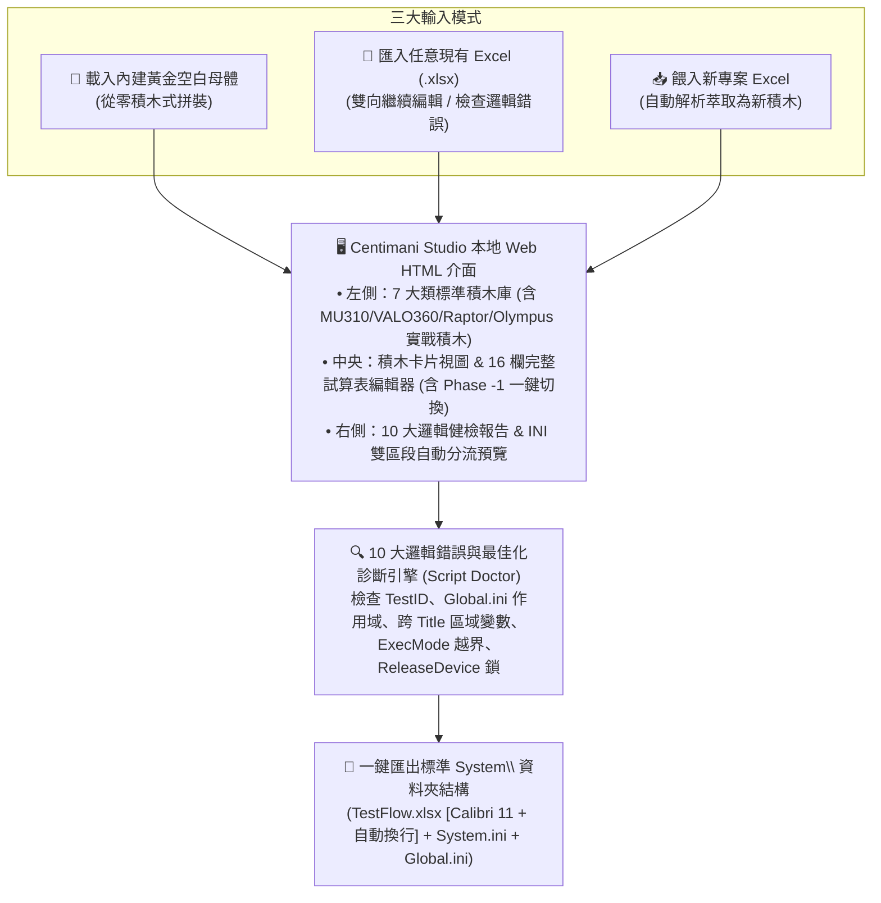

# Centimani 自動化測試腳本生成、雙向編輯與邏輯健檢系統規格說明書 (spec.md)

| 項目 | 內容 |
| :--- | :--- |
| **文件名稱** | Centimani 自動化測試腳本生成、雙向編輯與邏輯健檢系統規格說明書 (System Specification) |
| **版本** | V2.0.0 (整合 `AI_SOURCE` 官方最新手冊 Ver1.65 與 10 大邏輯健檢引擎) |
| **適用範圍** | 和碩 (PEGATRON) CVP RD3 / 產線測試自動化工具開發 |
| **狀態** | 規格定案，進入系統實作階段 |

---

## 📌 目錄
1. [專案背景與技術路線評估 (Technical Approach)](#1-專案背景與技術路線評估-technical-approach)
2. [Centimani v1.5.3 測試程式包完整目錄架構與部署 SOP](#2-centimani-v153-測試程式包完整目錄架構與部署-sop)
3. [系統核心架構：黃金空白母體 + 雙向讀寫 + 10 大邏輯健檢引擎](#3-系統核心架構黃金空白母體--雙向讀寫--10-大邏輯健檢引擎)
4. [Excel 測試腳本規格標準 (16 欄主站位表含 TestID)](#4-excel-測試腳本規格標準-16-欄主站位表含-testid)
   - [4.1 黃金空白母體工作表 (Properties / DUTs / Switch / Instrument)](#41-黃金空白母體工作表-properties--duts--switch--instrument)
   - [4.2 主測試站點工作表 (Station Sheet, 16 大標準欄位)](#42-主測試站點工作表-station-sheet-16-大標準欄位)
   - [4.3 射頻/微指令副工作表 (Marco Sheet, 11 大標準欄位)](#43-射頻微指令副工作表-marco-sheet-11-大標準欄位)
   - [4.4 排版與視覺化規範 (Calibri 11 + Wrap Text)](#44-排版與視覺化規範-calibri-11--wrap-text)
5. [INI 設定檔規格與雙區段作用域自動分流規則](#5-ini-設定檔規格與雙區段作用域自動分流規則)
   - [5.1 System.ini 9 大標準區段與 Checksum 簽章機制](#51-systemini-9-大標準區段與-checksum-簽章機制)
   - [5.2 Global.ini `[Settings]` vs `[Scripts]` 嚴格作用域分流](#52-globalini-settings-vs-scripts-嚴格作用域分流)
6. [標準測項積木庫與外部 Python 腳本呼叫規範](#6-標準測項積木庫與外部-python-腳本呼叫規範)
7. [10 大邏輯錯誤檢查與寫法優化診斷引擎 (Script Doctor)](#7-10-大邏輯錯誤檢查與寫法優化診斷引擎-script-doctor)
8. [本地 Web HTML 操作介面規格 (Local Web UI Spec)](#8-本地-web-html-操作介面規格-local-web-ui-spec)

---

## 1. 專案背景與技術路線評估 (Technical Approach)

* **實務作業模式**：測試工程師習慣以「空白母體 Excel」為基底，從既有專案（如 `VALO360`、`KANGAROO/MU310`、`Raptor`、`Olympus`）一段段搬運測試積木貼上，並配置 `System.ini` 與 `Global.ini`。
* **技術路線**：採用 **「結構化規則引擎（Rule-Based & Golden Template Engine）+ 雙向 Excel 讀寫器 + 10 大邏輯健檢器」**，捨棄容易產生隨機幻覺的純深度學習（DL）生成，確保產出的每一格指令、每一個 `TestID` 與每一行 INI 設定 **100% 符合 `CentimaniSystem.exe` 與 `EditorScriptTool.exe` 規範**。

---

## 2. Centimani v1.5.3 測試程式包完整目錄架構與部署 SOP

根據 `Centimani_1.5.3_整包執行檔.7z` 與官方手冊，標準測試程式包結構如下：

```text
📁 Centimani_1.5.3_FINAL\ (測試程式根目錄)
 ├── 🚀 CentimaniSystem.exe                     # [主測試引擎] 執行產線測試
 ├── 🛠️ EditorScriptTool.exe                    # [官方簽章工具] 驗證第 16 欄 TestID、自動編排 Index、產生 64 碼 Checksum 寫入 System.ini
 ├── 📝 CentimaniTrace.log                      # [簽章除錯日誌] EditorScriptTool 檢查失敗時記錄異常行號與原因
 ├── 📁 System\                                 # ★ [核心腳本與設定檔目錄] 寫完的 Excel 與 INI 必須放這裡！
 │    ├── [Project]_TestFlow_[Station].xlsx     # 主測試腳本 (16 欄格式)
 │    ├── Test Item Code V2.04_20250310.xlsx    # 官方 7 碼 TestID 與 6 碼 SFIS 錯誤碼對照表 (5,349+ 筆)
 │    ├── System.ini                            # 系統設定與 [Checksum] 簽章存放檔
 │    └── Global.ini                            # 全域變數檔 ([Settings] 供 DUTs/Instrument 用；[Scripts] 供 Station 用)
 ├── 📁 API\                                    # 存放 DUTs 表中以 "DLL:xxx.dll" 掛載之擴充庫 (UtilityLibrary.dll, DutLibrary.dll 等)
 ├── 📁 Device\                                 # 存放 Instrument 表掛載之硬體驅動 DLL (iPower2401.dll, DaqUSBNi.dll, LED_analyser.dll 等) 與線損 .ini
 ├── 📁 Switch\                                 # 存放 Switch 表掛載之切換器 DLL (RFSwitch3001.dll)
 ├── 📁 Image\                                  # 存放 :ShowImageMessage 提示圖檔 (Loimage.gif, waitboot.jpg, PutDUT.JPG 等)
 ├── 📁 IQmeasureA\ & 📁 IQmeasureB\            # LitePoint IQxel 射頻底層組件
 └── 📁 Log\ & 📁 Report\ & 📁 Record\          # 存放 System.log、單板 PASS/FAIL.log 與測試報告 (.ct)
```

---

## 3. 系統核心架構：黃金空白母體 + 雙向讀寫 + 10 大邏輯健檢引擎



---

## 4. Excel 測試腳本規格標準 (16 欄主站位表含 TestID)

### 4.1 黃金空白母體工作表 (前 4 個環境配置 Sheet)
1. **`Properties`**：`Version`、`Creator`、`FailCount`。
2. **`DUTs`**（最多支援 `Connection1` ~ `Connection10`）：
   - 支援連線型態：`Uart`、`SSH`、`TCP`、`UDP`、`HTTP`、`APP` (`cmd.exe`)、`DLL:UtilityLibrary.dll`（須放於 `.\API\`）。
   - `Station` 欄位格式：`站別名稱,SkipConfirm(0/1)`（設 `0` 啟動前會跳出 `"Is DUT Ready ?"`）。
   - `Parameter` 欄位：以逗號分隔傳入 Station Sheet 的 `{0}`, `{1}`, `{2}`... 參數。
3. **`Switch`**：掛載 `RFSwitch3001.dll` 等切換器。
4. **`Instrument`**：完整收錄 `Ver1.65` 標準儀器定義（`iPower2401`, `iPowerPro800`, `DaqUSBNi`, `MDA2700`, `DAQ970A`, `LED_analyser`, `DigitIO6509`, `DaqNI4461`, `QRDecode`, `FM480`, `InstIQApi_A/B`, `PSS2005`, `PSH1503`, `Agilent34401A`, `SCPI_Controller`, `DevUart` 等）。

### 4.2 主測試站點工作表 (Station Sheet, 16 大標準欄位)
根據 `Centimani Script User Guide(202230104).xlsx`，主站位表必須具備 **16 個標準欄位**：

| 欄序 | 欄位名稱 (Header) | 規範格式 | 核心邏輯與官方備註 |
| :---: | :--- | :--- | :--- |
| **1** | **`Index`** | `Index_[總列數]` / `000, 001...` | 唯一序號（手寫可留空交由 `EditorScriptTool` 自動產生；本系統會自動連續編號）。 |
| **2** | **`Phase`** | `-1`, `0`, `1~96`, `97`, `98`, `99` | `-1`: Disable Run；`0`: Pretest（不計入 Cycle Time）；`1~96`: Normal Test（不建議重複號碼）；`97`: End Test（必執行收尾）。 |
| **3** | **`Title`** | `(RunMode,)Title(,RetryCount)` | RunMode: `0` (Normal), `1` (Always Run), `2` (Skip), `3` (Run on Fail)。 |
| **4** | **`Marco`** | 副工作表名稱 | 呼叫 Marco Sheet 名稱（參數填於 `Send` 欄）。 |
| **5** | **`Instrument`** | 儀器 Function 名稱 | 對應 `Instrument` 表之 `Functions`（如 `POWERSWITCH`, `Voltage`, `LED_Test`）。 |
| **6** | **`Switch`** | 切換路徑 | 如 `RFSwitch,"DUT(1):Switch(L1)"`。 |
| **7** | **`Send`** | 發送指令 | 內建指令 (`:Delay`, `:CheckLimit` 等)、連線指令 (`UART@...`, `CmdConsole@...`)、儀器指令 (`:Dev.VOLTAGE,...`)、擴充庫 (`:Utility.Ping,...`)。 |
| **8** | **`Reply`** | 預期結果比對 | `abc` (完全相等)、`@abc` (包含)。多條件 `&&` 與 `||` **不可混用**，且用 `&&` 時必須加 `@`。 |
| **9** | **`EndPrompt`** | 結束提示符 | `#`、`/#`、`$`、`>`（確認已完成回覆，加速測試減少等待）。 |
| **10** | **`Ref`** | 儲存結果與字串處理 | **無 `$` 為區域變數（僅在同一 `Title` 區塊內保留，換 `Title` 即清除！）**；**加 `$` 為全域變數（跨 `Title` 皆可使用）**。 |
| **11** | **`Validation`** | `(KeyName,ValueType,DL,UL)` | 型態支援 `%s`, `%d`, `%f`, `%x`, `%len`；多組驗證以分號 `;` 隔開。 |
| **12** | **`Prompt`** | 前置提示符 | 收到特定提示後才執行命令；填 `!` 代表發送前保留不清除 Connection Buffer。 |
| **13** | **`Waiting`** | 超時毫秒 (ms) | 等待 DUT 回覆的 Timeout 時間。 |
| **14** | **`ExecMode`** | 執行模式 (`0~9`) | `0`:Normal, `1`:Direct Retry, `2:RetryPoint`, `3`:Continue, `4:PassStep,FailStep`, `5`:Run on Fail, `6`:Skip, `7:LoopStep,timeout`, `8`:SFIS Normal, `9`:SFIS Retry。<br>⚠️ **`RetryPoint` 與 `Step` 均以同一 `Title` block 第一行為 `0` 往下遞增；`ExecMode=4` 不可往回跳！** |
| **15** | **`Description`** | 步驟備註 | 如 `PC#-#Show ISN to UI`、`DUT#-#Check Voltage`。 |
| **16** | **`TestID`** | **7 碼測項代碼** | **必須存在於 `Test Item Code V2.xx.xlsx` 中**（如 `B7PL025`, `OTFX064`, `BRPW033`），否則 `EditorScriptTool` 簽章會阻斷！ |

### 4.3 射頻/微指令副工作表 (Marco Sheet, 11 大標準欄位)
* 欄位：`Index`, `Send`, `Reply`, `EndPrompt`, `Ref`, `Validation`, `Prompt`, `Waiting`, `ExecMode`, `Description`, `TestID`。

### 4.4 排版與視覺化規範 (Calibri 11 + Wrap Text)
* 全工作表統一使用 **`Calibri` 11 pt**（表頭粗體、藍灰底色 `#D9E1F2`）。
* 全儲存格強制啟用 **`wrap_text=True` 自動換行** + 動態欄寬自適應，確保所有文字完整顯示不截斷。

---

## 5. INI 設定檔規格與雙區段作用域自動分流規則

### 5.1 System.ini 9 大標準區段與 Checksum 簽章機制
完整包含：`[System]`, `[IpFinder]`, `[SFIS]`, `[FTP]`, `[MiniCloud]`, `[iPLAS]`, `[YRsetting]`, `[CSVReport]`, `[Checksum]`。
* **CheckSum 運作機制**：
  * 調試期設 `DebugMode=1`，免驗證 `[Checksum]` 直接執行。
  * 正式上線期將產出之檔案放於 `.\System\`，打開 `EditorScriptTool.exe` 按下 `Generate CheckSum`，即可自動將 64 碼簽章寫入 `System.ini` 的 `[Checksum]` 區段（格式：`檔名.xlsx=64碼簽章`）。

### 5.2 Global.ini `[Settings]` vs `[Scripts]` 嚴格作用域分流（關鍵鐵律！）
根據官方 `Centimani INI file setting(20210506).xlsx` 明文規定：
1. **`[Settings]` 區段**：**僅供 `DUTs` 與 `Instrument` 工作表參考取得設定（站位 `Station` Sheet 無法取得！）**。
   - 存放項目：`LOAD_1~4`, `DEVID_1~4`, `PCIP_1`, `DUTIP_1`, `DUT_UR1`, `PCUART_fixture`, `DAQ_1`, `LED_AZ1` 等硬體參數。
2. **`[Scripts]` 區段**：**僅供各站位 `Station` / `Marco` 工作表參考取得設定（`Instrument` & `DUTs` Sheet 無法取得！）**。
   - 存放項目：`FW_VERSION`, `sfisSKU`, `Boot_Delay`, `gSWVer`, `AP_SSID`, `AP_PW` 等測試步驟參數。
* **本系統自動分流機制**：匯出時自動分別掃描「環境表 (`DUTs`/`Instrument`)」與「站位表 (`Station`/`Marco`)」中的 `*$(變數名)`，並精準歸入 `[Settings]` 與 `[Scripts]`，若兩邊皆有使用則雙邊同步寫入，確保 100% 讀取成功！

---

## 6. 標準測項積木庫與外部 Python 腳本呼叫規範

整合 `VALO360`、`KANGAROO (MU310 / Olympus)`、`Raptor`、`MiniBox`、`APOC` 真實量產積木：
1. **前置與 SFIS 路由積木 (`Phase 0/1`)**：`:ShowISN` ➔ `:SfCheckRoute` (`ExecMode=8/9`) ➔ 氣動治具控制 (`UARTF@G\r\n` / `atk_fixture`) ➔ iPower 上電。
2. **真實產線電壓量測積木 (NI6008 `DaqUSBNi.dll` & Keithley `MDA2700.dll` / `DAQ970A.dll`)**：
   - 模式 A (NI6008 多通道批次量測 + `:CheckLimit`)：`:ObtainDevice` ➔ `:Dev.VOLTAGE,"RSE,1000,0,4,5"` (`Ref` 接收多變數) ➔ `:ReleaseDevice` (`ExecMode=3`) ➔ `:CheckLimit,"*(V_RAIL)","DL","UL","%f"` (`ExecMode=2:0`)。
   - 模式 B (單軌直接 Validation 判定)：搭配 `Ref` 與 `Validation: (V_RAIL,%f,DL,UL)`。
3. **UART / SSH / Telnet / OpenWrt 系統與韌體檢查積木**：連線、登入、讀取 FW Version、MAC、69PN、SKU 設定、溫度檢查。
4. **外部 Python 腳本呼叫積木 (免做 DLL！)**：
   - 方式 A (`CmdConsole`)：`:Connect,"CmdConsole"` ➔ `CmdConsole@python.exe Script.py "參數"\r\n` (`EndPrompt: >`, `Ref: $Val:WithinString,...`) ➔ `:Disconnect,"CmdConsole"` (`ExecMode=3`)。
   - 方式 B (`UtilityLibrary`)：`:Utility.CMD,"python.exe","Script.py *(ISN)","ON","-1"`。
5. **LED / Acoustic 音訊 / WiFi & BT 射頻積木**。
6. **Phase 97 強制安全收尾積木**：斷電、治具抬起、`:ReleaseDevice` (`ExecMode=3`)、`:Disconnect` (`ExecMode=3`)。

---

## 7. 10 大邏輯錯誤檢查與寫法優化診斷引擎 (Script Doctor)

系統內建獨立的腳本健檢模組，可針對**使用者匯入的任何現有 Excel 腳本**或**當前編輯中的腳本**執行 10 大檢查，並分為 `❌ 阻斷錯誤 (Error)`、`⚠️ 邏輯警告 (Warning)`、`💡 優化建議 (Tip)`：

1. **核心環境工作表與 16 欄表頭檢查**（確認第 16 欄 `TestID` 存在）。
2. **`TestID` 合法性與非空檢查**（比對 `Test Item Code V2.04` 內建字典）。
3. **`Global.ini` `[Settings]` 與 `[Scripts]` 作用域錯置檢查**（抓出站位表誤讀 `[Settings]` 的 Bug）。
4. **區域變數（無 `$`）跨 `Title` 區塊失效偵測**（抓出因未加 `$` 導致換 Title 後變數被清空的隱形 Bug）。
5. **`ExecMode 2:RetryPoint` 與 `4:Pass,Fail` 相對步號越界與往回跳檢查**（抓出超過當前 Title 行數或往回跳造成死迴圈的 Bug）。
6. **`:ObtainDevice` / `:ReleaseDevice` 成對與 `ExecMode=3` 檢查**（防止儀器死鎖）。
7. **`Phase` 狀態機順序、重複 Phase 與 `Phase 97` 收尾完整性檢查**。
8. **`Reply` 多條件邏輯 (`&&` 與 `||` 混用、漏加 `@`) 檢查**。
9. **`Validation` 括號語法、型態 (`%f/%d/%s/%x/%len`) 與上下限倒置 (`DL > UL`) 檢查**。
10. **`Index_XXX` 表頭列數一致性與 `EndPrompt` 加速建議檢查**。

---

## 8. 本地 Web HTML 操作介面規格 (Local Web UI Spec)

提供單頁式現代化工控 Web 介面（支援手型游標與懸停變色回饋）：
* **分頁 1：🧱 積木拼裝與 16 欄試算表編輯器**（左側點選積木插入母體、中央直接編輯 16 欄儲存格、一鍵切換 `Phase -1` 跳過、選取多行存為自訂積木）。
* **分頁 2：🔍 腳本邏輯健檢與優化診斷 (Script Doctor)**（支援一鍵上傳/選擇電腦中任何現有 `.xlsx` 進行 10 大邏輯體檢，列出錯誤行號、原因與一鍵自動修復按鈕！）。
* **分頁 3：🔌 母體環境表 (`Properties` / `DUTs` / `Switch` / `Instrument`) 編輯器**。
* **分頁 4：⚙️ `System.ini` & `Global.ini` 雙區段智慧同步配置**。
* **頂部一鍵動作**：`📄 重置為黃金空白母體`、`📂 載入現有 Excel 編輯/健檢`、`🔧 一鍵自動修復邏輯問題`、`💾 匯出標準 System\ 整包檔案`。
